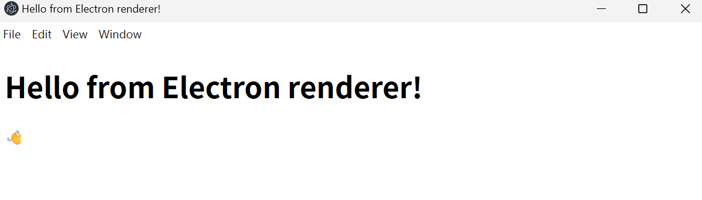
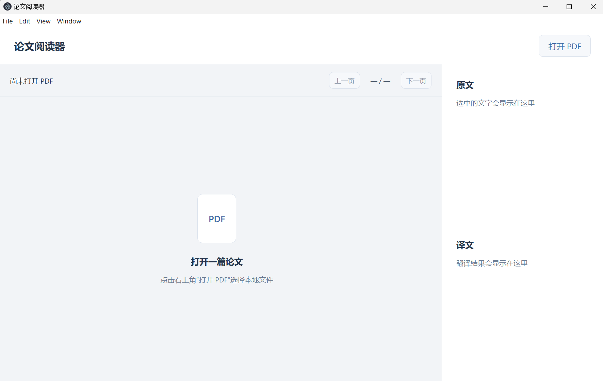
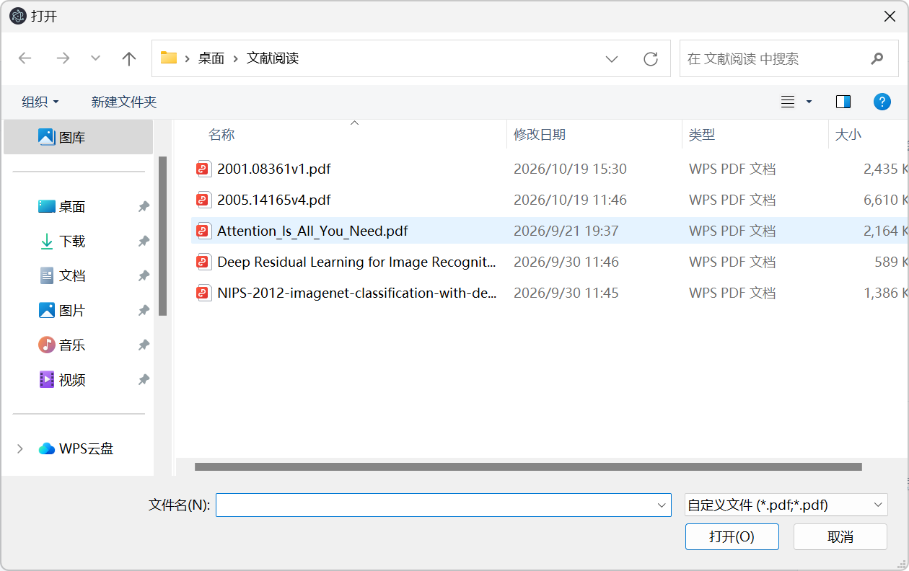
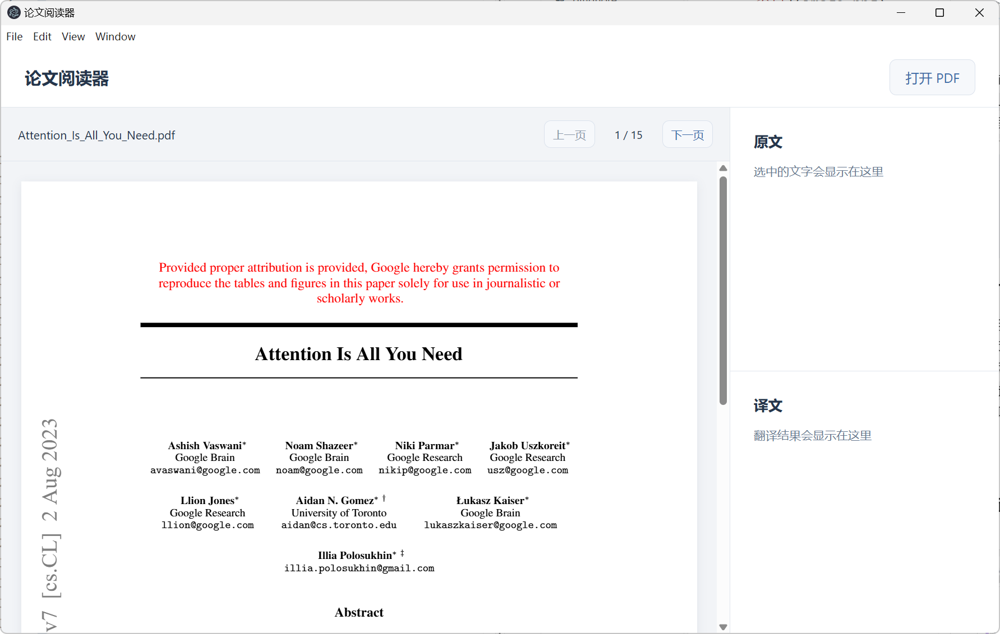

### [Electron官方教程](https://www.electronjs.org/zh/docs/latest/tutorial/tutorial-first-app)

#### 先```npm init```初始化 npm 项目 `npm install electron --save-dev`下载依赖

文件夹中会出现一个`node_modules`文件夹，其中包含了 Electron 可执行文件；还有 `package-lock.json` 文件，指定了各个依赖的确切版本，`package.json`告诉 npm这个项目叫什么、依赖哪些包、怎么运行、怎么构建

#### 添加文件：

- `main.js`控制主程序，它运行在 Node.js 环境里，负责控制应用的生命周期、显示原生界面、执行特殊操作并管理渲染器进程
- `index.html`展示页面的前端文件
- `style.css`安排页面布局
- `.gitignore`指定哪些文件和目录应该在Git中不被跟踪([参见 GitHub 的 Node.js gitignore](https://github.com/github/gitignore/blob/main/Node.gitignore))

#### 运行Electron窗口



在ai的帮助下完成对前端文件`index.html` `style.css`代码的书写，呈现的页面如下


#### 接下来在ai的指导下添加PDF解析功能
使用PDF.js 负责理解 PDF 并绘制页面（[PDF.js 官方示例](https://mozilla.github.io/pdf.js/examples/)）
先添加pdfjs的依赖```npm install pdfjs-dist```
添加文件：
- `reader.js`给按钮安排动作，并负责打开、绘制和翻页

#### 下面打开预先准备PDF文件

#### PDF正常渲染


#### 接下来先将第一阶段项目使用git保存本地版本，再上传github
