### [Electron官方教程](https://www.electronjs.org/zh/docs/latest/tutorial/tutorial-first-app)

#### 先```npm init```初始化 npm 项目 `npm install electron --save-dev`下载依赖

文件夹中会出现一个`node_modules`文件夹，其中包含了 Electron 可执行文件；还有 `package-lock.json` 文件，指定了各个依赖的确切版本，`package.json`告诉 npm这个项目叫什么、依赖哪些包、怎么运行、怎么构建

#### 添加文件：

- `main.js`控制主程序，它运行在 Node.js 环境里，负责控制应用的生命周期、显示原生界面、执行特殊操作并管理渲染器进程
- `index.html`展示页面的前端文件
- `style.css`安排页面布局
- `.gitignore`指定哪些文件和目录应该在Git中不被跟踪([参见 GitHub 的 Node.js gitignore](https://github.com/github/gitignore/blob/main/Node.gitignore))

#### 运行Electron窗口

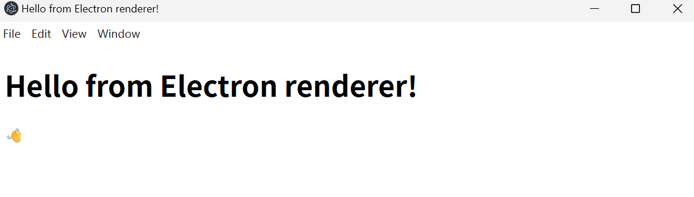

在ai的帮助下完成对前端文件`index.html` `style.css`代码的书写，呈现的页面如下
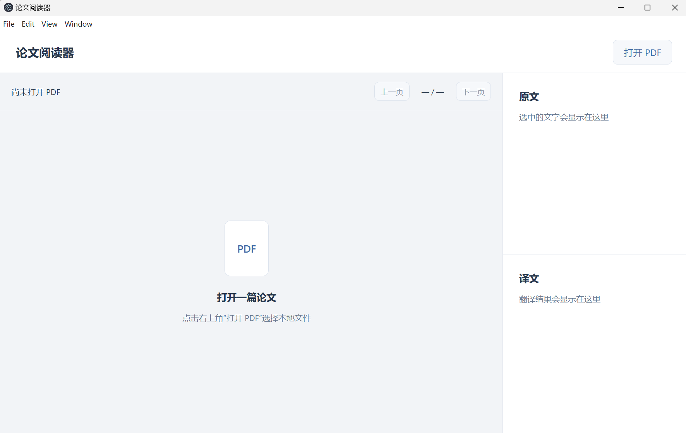

#### 接下来在ai的指导下添加PDF解析功能
使用PDF.js 负责理解 PDF 并绘制页面（[PDF.js 官方示例](https://mozilla.github.io/pdf.js/examples/)）
先添加pdfjs的依赖```npm install pdfjs-dist```
添加文件：
- `reader.js`给按钮安排动作，并负责打开、绘制和翻页


#### 下面打开预先准备PDF文件
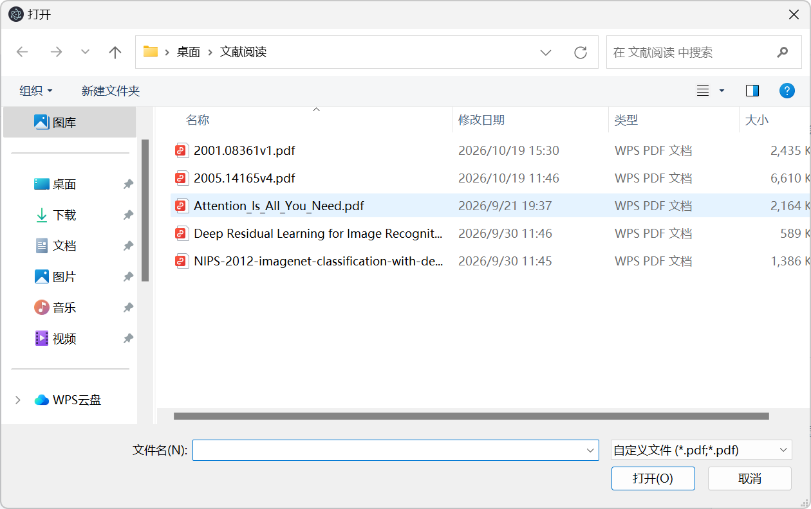
#### PDF正常渲染
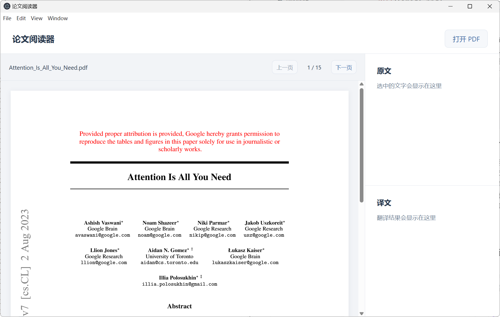

#### 接下来先将第一阶段项目使用git保存本地版本，再上传github
```
git init -b main
git config user.name "略"
git config user.email "略"

git add .
git status

git commit -m "完成 PDF 解析与基础阅读功能"
git log --oneline

git remote add origin https://github.com/略/paper_reader.git
git push -u origin main
```
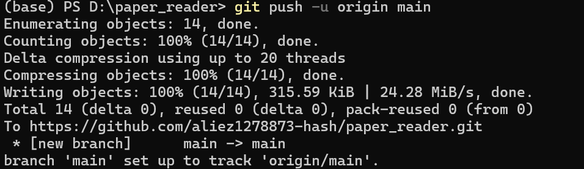
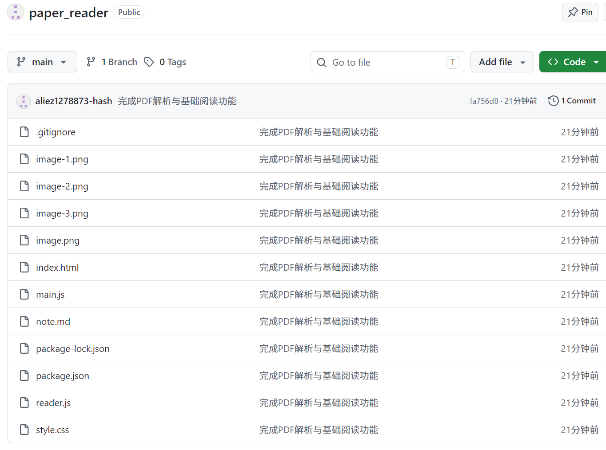

#### 当前已经完成了PDF的解析跟阅读功能，接下来的任务是能使用鼠标拖选文字，并显示在右侧原文区，翻页后清除旧选区
##### 实现方式：在画布上方再放一层真正可选的网页文字
```
用户鼠标操作
      ↓
上层：透明的文字层——可以选择文字
下层：Canvas 画布——负责页面的视觉效果
```
##### 页面外观来自下方画布，选择文字的能力来自上方文字层


- 我修改`reader.js`创建文字层，接收选区变化，将有效选区显示到右侧
- ai修改`index.html`为画布和文字层安排同一个容器,给右侧原文加上可查找的 ID
- ai修改`style.css`让两层重叠，普通正文按面板宽度换行
  


##### 实际选区测试
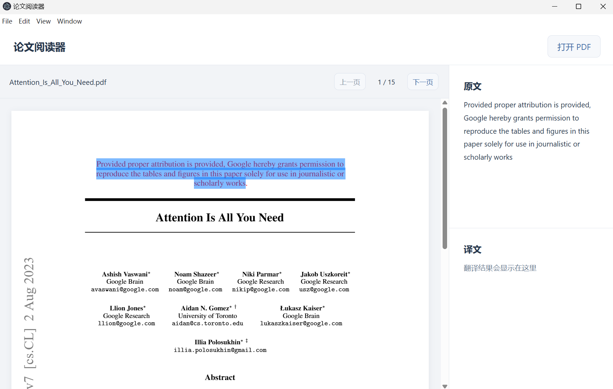
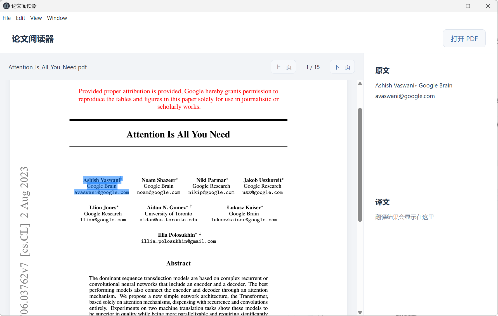
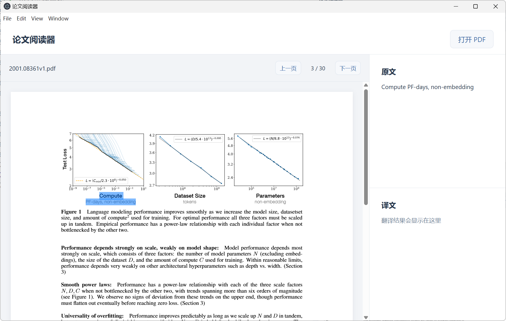
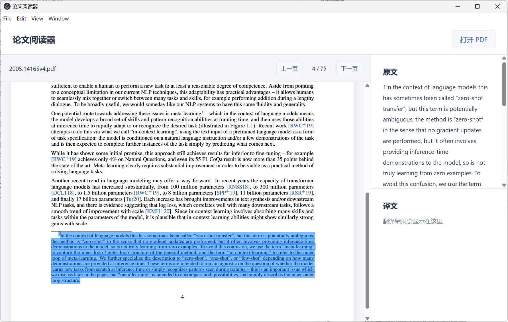
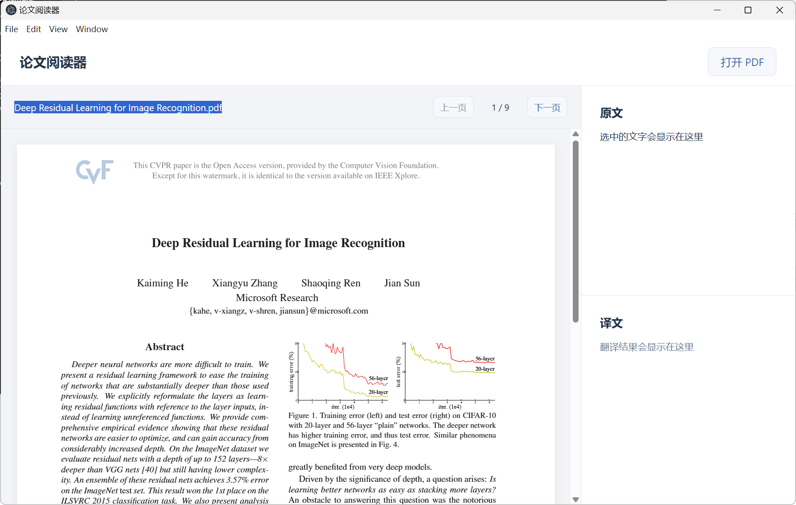
##### 文字选区没发现错误，使用起来也很跟手，高亮部分也没错位，但是公式识别跟特殊符号识别不好，文字的排版也没有特别好，贴图里的文字没法选取，水印的文字也无法选取，PDF外的文字选区没有录入右边的显示区

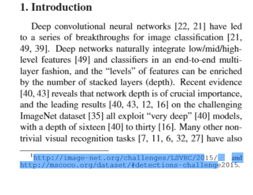
#### 发现高亮部分有错位
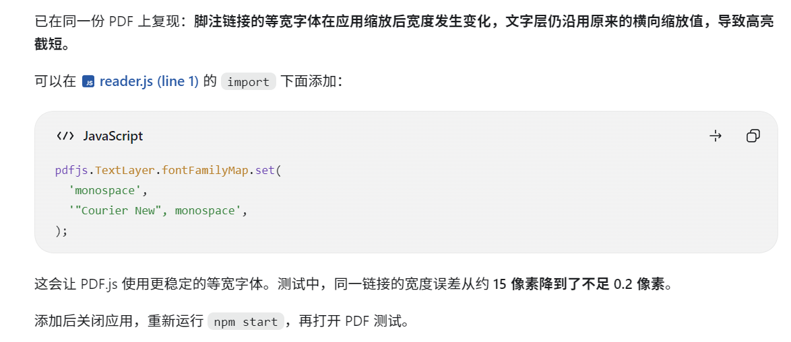
在ai的帮助下找到问题
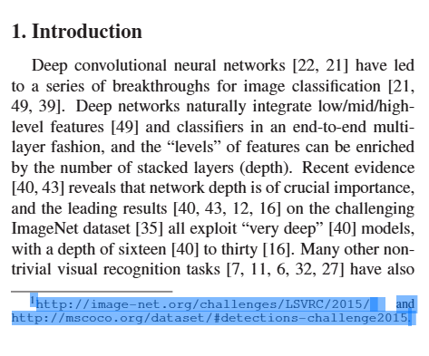

#### 部分问题解决第二版暂时git存档
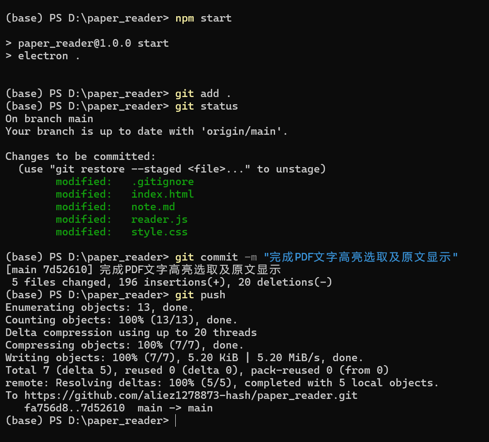